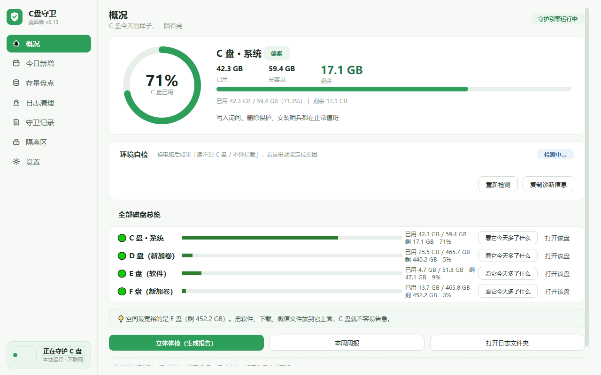
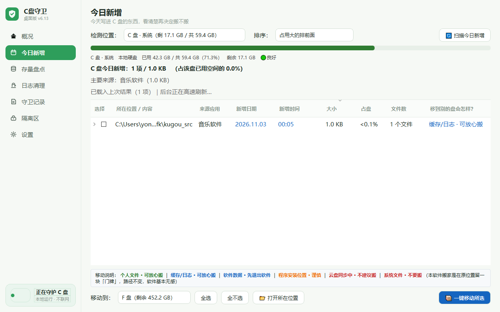
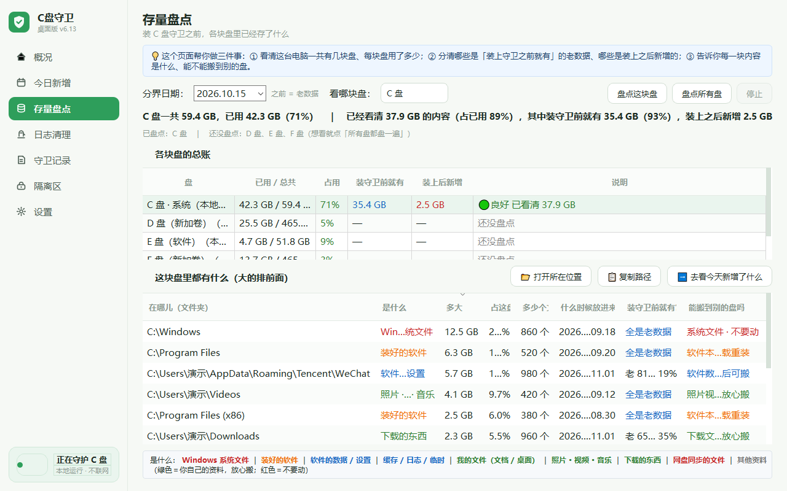
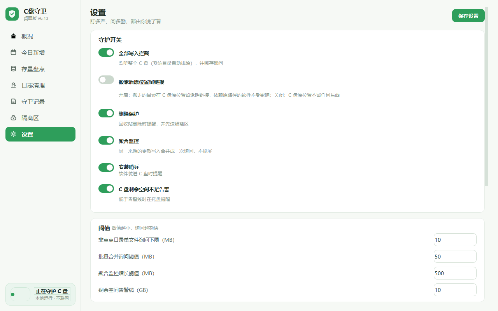

# C盘守卫 (C Disk Guard)

一款 Windows 桌面端的 C 盘保护软件：实时监测 C 盘新增内容、归因来源应用、拦截大文件写入、一键搬家释放空间。基于 Python + PySide6 构建，界面全中文。

  

## 🖱️ 扫描时界面不卡（v6.13）

扫描和界面彻底分离，扫得再猛、点击也即时响应（实测扫描满载期间界面延迟平均 0.3 毫秒）：

- **留一核给界面**：扫描线程数改为 CPU 核数减 1，不再把 CPU 吃满
- **主动让出**：扫描引擎每处理一层目录主动让出执行权，界面随点随到
- **进度不再轰炸**：进度刷新按时间节流（≥100ms 一次），不会刷爆主线程
- **表格重建暂停重绘**：几千行的结果表一次性上屏，重建期间不逐行闪算
- **数据没变不重刷**：60 秒自动刷新先比对数据指纹，没变化就直接跳过
- **日志清理提速 + 实时进度**：单线程逐文件循环改走并发引擎，预算/上限触发立即全局停止；扫描中实时显示「已检查多少文件」
- **结果聚合提速**：大表分组从 pathlib 换成 os.path，上屏更快

## ⚡ 扫描速度（v6.12）

C 盘文件多时不再「蜗牛爬」。新版采用 **一次 `os.scandir` 取全元数据 + 按目录多线程并发**，
不再对每个文件单独 `os.stat(完整路径)`；自动跳过 junction 环路，多块盘同时盘点。

本机实测（同一目录，改造前 → 改造后）：

| 场景 | 改造前 | 改造后 | 提速 |
|---|---|---|---|
| 今日新增 · `C://Windows//WinSxS`（7.3 万文件） | 59.7 s | 4.6 s | **13×** |
| 今日新增 · `AppData\Local`（3 万文件） | 4.3 s | 0.6 s | **7×** |
| 存量盘点 · `C://Windows//WinSxS` | 13.6 s | 9.9 s | 1.4× |

另外：
- **启动秒开**：先显示上次扫描结果（毫秒级），后台再静默高速刷新，不用盯着空白等
- **多盘并行**：点「盘点所有盘」时几块盘同时扫，不再逐个排队
- **耗时可见**：扫描中显示已用秒数，完成后显示本次用时与并发线程数
- 线程数默认按 CPU 核数取（最多 8），可用环境变量 `GUARD_SCAN_WORKERS` 调整

新旧算法结果逐项比对通过（`_test_fastscan.py`，23 项断言），提速不改变任何统计口径。

## 📸 界面预览

| 概况 —— 一眼看清 C 盘 | 今日新增 —— 谁在往 C 盘塞东西 |
|:---:|:---:|
|  |  |

| 存量盘点 —— 装守卫之前谁占的空间 | 设置 —— 阈值多少你说了算 |
|:---:|:---:|
|  |  |

> 截图由 `_shot_readme.py` 离屏渲染生成，页面中的数据为演示数据。

## ✨ 核心功能

### 🎨 全新界面（v6.7）

左侧竖排导航共 7 页（**概况 / 今日新增 / 存量盘点 / 日志清理 / 守卫记录 / 隔离区 / 设置**），
概况页大圆环仪表盘 + 全部磁盘总览，设置页滑块开关；绿色主色 + 卡片式布局，
空列表显示插画式提示。主题集中在 `guard_theme.py`（配色 / QSS / 自绘组件）。

### 🖥️ 图形界面桌面软件
多页面主窗口，全中文界面，无需命令行，普通用户开箱即用。

### 🛡️ 托盘后台守护
点击窗口 **× 只是缩到系统托盘**，守卫继续在后台保护 C 盘，不会真正退出。托盘图标右键菜单提供：打开主界面、立即扫描、真正退出。

### 🚫 软件存储限制（你自己说了算 · v6.6 新增）

不希望某个软件往 C 盘塞东西？自己加一条规则就行——软件**不预置任何品牌名单**，全由你手动添加：

- **手动添加**：设置 → 软件存储限制 → 添加软件（软件名你自己起，比如「酷狗音乐」）
- **列表速加**：在「今日新增」列表里右键某一行 → 「禁止这个软件存到 C 盘」，会自动带上识别关键词
- 以后它一往 C 盘写东西，守卫立刻问你，四个选项任选：
  **搬到别的盘（你选盘）** / **这次就放 C 盘** / **不下载不安装（删除）** / **解除限制**
- 规则存本地 `app_rules.json`，随时改、随时删、可单独停用

> 场景：新下载了一个软件，安装时忘了改位置、装进了 C 盘 —— 提前把它加进限制名单，
> 它再往 C 盘写就会被拦下问你，你选一个盘，内容自动搬走并在原位置留下链接，软件照常能用。

### 📅 今日新增监测（来源归因）
实时扫描当天 C 盘新增的文件和目录，**自动识别产生这些内容的应用**，按「来源应用 + 目录」分组展示。

> 「来源应用」默认用一张**本地对照表**把路径翻译成人话（纯文字关键词匹配，无任何图标，不联网）。
> 不喜欢可以在「设置 → 来源显示方式」里一键关掉，关掉后只显示文件夹名，不再出现任何软件名称。
> 注意：这张表**只影响显示**，真正决定限制哪些软件的，是上面「软件存储限制」里你自己添加的规则。

- 今天 C 盘多了哪些内容
- 由哪个应用软件产生
- **新增时间**：完整格式 `2026.11.01  00:30`，优先取文件创建时间（非今天创建则取最后修改时间）；单文件显示一个完整时间，同目录多文件显示「最早 ~ 最晚」区间（同一天后半段省略日期，跨天显示两段完整日期）；展开父行可看每个文件各自时间
- 各占用了多少空间
- **一键定位**：双击任意一行（或点「📂 打开所在位置」）直接在资源管理器打开 C 盘真实位置，文件自动选中
- 支持勾选后**一键移动**到其他磁盘

### 🔀 三种排序

- **占用大小**（大→小 / 小→大）
- **新增时间**（最新→最早 / 最早→最新）
- **来源应用**（应用名排序）／**所在位置**（路径排序）

排序下拉切换，**或直接点列表表头**排序（点一下升序、再点降序）。

### 🧹 日志自动清理（v6.7 新增 · 治"什么都没干 C 盘也在变少"）

软件日志、崩溃记录、临时文件会一直偷偷长大——**这类东西不该搬走，直接删掉最合理**。

- **只清三类**：日志文件（`.log` 等及 log/logs 目录内的记录）、崩溃转储（`.dmp`）、Temp 里的旧文件。
  文档 / 照片 / 视频 / 安装包 / 软件本体一律不碰。
- **安全底线**：
  1. `Windows`、`Program Files`、`ProgramData` 等系统目录永不触碰；
  2. 只删「N 天没动过」（默认 3 天）或「大到离谱」（默认 ≥50 MB）的；
  3. **正在被写入的文件不自动删**，只在列表中标橙提示"建议先退出对应软件再清"；
  4. 自动清理**默认关闭**，需用户自行开启。
- **自动调度**：可设周期（默认 7 天）、最小清理量（默认 20 MB，不够多就不打扰）、
  清理前是否先询问（默认询问）。到点自动扫描并清理，托盘提示腾出空间。

### 🌐 全盘守护（v6.5 新增 · 不只是 C 盘）

- **自动识别所有磁盘**：下拉动态列出本机每一块盘（本地硬盘、U 盘自动出现，自动跳过空光驱），
  带卷标、已用/总容量、剩余空间、占用百分比
- **任意盘今日新增检测**：切换「检测位置」即可查看那块盘今天多了什么，各盘快照独立存放互不干扰
- **占盘%列**：每组内容占该盘**已用空间**的百分比，≥10% 标红、≥2% 标橙，一眼看清"是谁占了这块盘"
- **健康色条**：🟢 良好（<75%）／🟡 偏紧（75~88%）／🔴 告急（≥88%，提示清理）
- **概况页全盘总览**：所有盘实时状态，每块盘一行 + 占用条 + 「看这块盘今天多了什么」「打开该盘」按钮
- **移动到任意盘**：目标盘自动排除当前正在检测的盘，按剩余空间从多到少排序

> **写入拦截为什么只对 C 盘生效**：这是有意的设计取舍。往 D/E/F 盘存文件本来就是正常需求，
> 若也逐个弹窗，一天会弹上百次反而没法用。因此 C 盘享受"拦截 + 监控 + 搬家"全套保护，
> 其他盘提供"看得清 + 搬得走"的能力。

### 📦 存量盘点（v6.7 新增 · 回答"装守卫之前这些空间是谁占的"）

"今日新增"只能看到今天多了什么，可盘里绝大多数的东西是**很久以前就在那儿的**。
存量盘点就是把整个盘翻一遍，按月份记一本账：

- **分界日期可调**：默认取「守卫第一次出现在本机」的日期（自动按程序数据目录里最早的文件推断，也可手动改），
  改完立刻重算"之前 / 之后"两栏，不用重新扫描。
- **九类白话分类**：系统文件 / 已装软件 / 软件数据 / 下载 / 照片视频 / 文档 / 云同步 / 临时文件 / 其他，
  每类配颜色和图例，不用看懂路径也能明白。
- **总账 + 明细两栏**：上面一张总账表（每类占多少、多少个文件、占比），下面一张明细树（逐条列出具体目录）。
- **能不能搬也说清**：每一行标注「可以搬到别的盘」「建议留在原地（系统要用）」等白话结论，并按安全度配色。
- 支持只盘一块盘，或一次盘完所有盘；可随时停止。

### 📁 用户根目录新文件夹拦截（v6.1 新增）
`C:\Users\用户名` 下出现任何新文件夹（不看点开头、不看大小）都会弹窗询问，三种处置：

- **保留在 C 盘**：以后不再问这个文件夹
- **搬到其他盘并创建链接（推荐）**：文件夹实体移到其他盘，原位置留一个透明 junction 链接——相关软件照常使用，C 盘空间立即释放
- **稍后再问**：1 小时后再提醒

OneDrive、桌面/文档/下载等系统固定目录在白名单内；搬移失败自动回滚，绝不丢数据。

### 📝 写入询问 · 二级选择流程
检测到新文件要写入 C 盘时弹窗询问：

- **是** → 仍然保存到 C 盘
- **否** → 跳出二级选择：选择电脑上其他磁盘存放（列出各盘及剩余空间），或取消（不保存/不下载）

### 📊 其他能力
- C 盘空间体检报告 + 周报（HTML 格式，存于 `guard_log/`）
- 软件体检：扫描 C 盘已安装软件的可搬移项，聚合搬移释放空间
- 回收站、休眠文件、系统缓存等大项清理建议
- 守卫记录 CSV 日志，所有拦截/搬移行为可追溯
- 单实例锁：重复启动自动提示，不会开多个守卫

## 📦 下载使用

1. 前往 [Releases](../../releases) 下载 `C盘守卫.exe`（便携版，免安装）；
2. 放到任意目录（建议非 C 盘）双击运行；
3. 首次启动会自动开始后台守护，窗口可关闭、程序驻留托盘。

> 系统要求：Windows 10 / 11（64 位）

## 🔨 从源码构建

```bash
# 1. 安装依赖（Python 3.10+）
pip install -r requirements.txt          # 只运行界面，装这个就够
pip install -r requirements-dev.txt      # 需要打包成 exe 时再装

# 2. 直接运行
python guard_gui.py

# 3. 打包为单文件 exe（产物在 dist/C盘守卫.exe）
pyinstaller --noconfirm --clean CDiskGuardGUI.spec
```

### 源码结构

| 文件 | 说明 |
|---|---|
| `guard_gui.py` | GUI 主程序：主窗口、系统托盘、今日新增页、写入询问弹窗（是/否 + 二级选盘） |
| `guard_bridge.py` | 线程桥：引擎线程与 UI 线程之间的问答请求转发（含主线程直通防死锁） |
| `guard_today.py` | 今日新增扫描器：增量扫描 + 来源归因（可关闭）+ 分组聚合 |
| `guard_rules.py` | 用户自定义「软件存储限制」规则：增删改查 + 命中判断（无预置品牌名单） |
| `guard_cleaner.py` | 日志/崩溃转储/临时文件清理：分类规则、扫描（带时间预算）、分组、删除、自动调度 |
| `guard_legacy.py` | 存量盘点：全盘目录聚合扫描、九类白话分类、按月记账、可搬移性判断 |
| `guard_theme.py` | 主题中心：配色表 / QSS 样式 / 自绘组件（开关、仪表盘、导航按钮、空状态） |
| `c_disk_guard.py` | 守卫引擎：磁盘监控、写入拦截、大文件处置、软件体检、日志 |
| `guard_quarantine.py` | 隔离/搬移模块：文件与整个应用目录的安全迁移 |
| `CDiskGuardGUI.spec` | PyInstaller 打包配置（onefile + windowed） |
| `使用说明_桌面版.txt` | 面向使用者的操作说明 |

## 💾 数据存在哪 / 换台电脑用（v6.9）

程序运行时的数据（今日新增、存量快照、守卫记录、配置）**只写在本机**，规则如下：

| 情况 | 数据目录 |
|---|---|
| exe 所在目录可写（U 盘、普通文件夹） | **exe 同目录**（便携模式，数据跟着走） |
| exe 装在 Program Files 等只读位置 | `%LOCALAPPDATA%\CDiskGuard` |
| 上面都不行 | `%TEMP%\CDiskGuard`（兜底） |

**把程序拷到另一台电脑会怎样？** 换电脑后首次启动会自动做一次「本机适配」：

- 检测到数据来自另一台电脑 → 把旧数据整体归档到 `_外来数据_备份/`，**绝不直接删**；
- 扫描数据（今日新增、存量快照、根目录基线）全部清空重建，看到的**一定是这台电脑自己的内容**；
- 配置里指向上一台电脑用户目录的路径（`C:\Users\旧用户名\...`），自动改指当前登录用户，
  否则监控的是一个不存在的目录、拦截永远不触发；
- 用户自己添加的软件规则（`app_rules.json`）与机器无关，予以保留。

> 这一条修的是一个真实故障：整个目录拷到新电脑后，界面显示的还是旧电脑的扫描结果，
> 且因配置文件写着旧电脑的路径，写入拦截完全失效。现在不会再发生。

## 🛡 拦截范围与搬家行为（v6.10）

**监听范围**：写入拦截监听**整个 C 盘**（递归）。往 C 盘任何位置复制/移动/下载文件
——包括盘根目录——都会弹窗询问。系统目录（Windows、Program Files、ProgramData 等）
与缓存类目录自动排除，不会刷屏。

**目录搬家**：把文件夹搬到其他盘后，默认 **C 盘原位置清空、不再保留**，
只出现在目标盘。可在「设置 → 守护开关 → 搬家后原位置留链接」改回透明链接模式
（链接模式适合依赖固定路径的软件数据）。例外：**软件安装目录**的迁移始终保留链接，
否则软件快捷方式会失效。

## ⚠️ 隐私说明

本软件完全**本地运行，不联网、不上传任何数据**。`guard_log/`、`today_files.json` 等运行数据文件已被 `.gitignore` 排除，不会进入仓库。

## 📜 第三方声明与知识产权

详见 [THIRD_PARTY_NOTICES.txt](THIRD_PARTY_NOTICES.txt)。要点：

- **应用图标**（蓝 C + 绿盾 + 白锁）基于项目方提供的品牌设计稿制作，由 `make_icon.py` 程序化完成抠底与多尺寸生成，版权归项目作者所有；
- **全部源代码为独立开发**，不含有第三方拷贝代码；
- 界面与文档中提及的第三方应用名称（微信、QQ、Chrome、Steam、NVIDIA 等）**仅用于识别文件来源**这一功能性用途，相关商标归各自权利人所有，本项目与上述厂商无任何隶属或背书关系；
- 界面使用 Windows 系统自带的微软雅黑字体渲染，**不分发任何字体文件**；
- 以动态链接方式使用 PySide6 / Qt 6（LGPLv3），用户可自行替换 Qt 库。

## 📄 许可证

本项目基于 [MIT License](LICENSE) 开源——他人可自由使用、修改、分发，但须保留版权署名。
